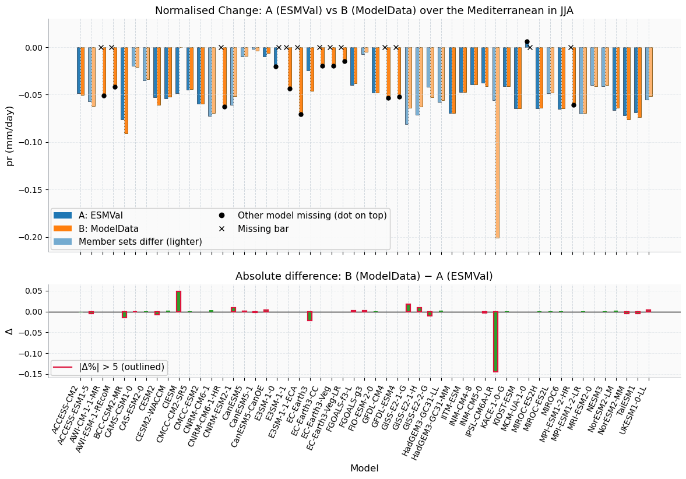

.. _overview:

.. # define a hard line break for HTML
.. |br| raw:: html

    

.. # define a double hard line break for HTML
.. |brr| raw:: html

      

Overview
========

**storypy makes dynamical storyline analysis of climate model ensembles efficient and accessible, for research and for policy applications.**

Representing model uncertainty may be relevant for a lot of applications, yet the analysis is not trivial and requires a lot of data processing and expert knowledge. This tool can help bring together experts with stakeholders to understand uncertainty at the regional scale with the technical part not being an issue, leaving more time for science, interpretation and communication.

What are storylines?
--------------------

The uncertainty in the response of the climate system to anthropogenic forcing is large. At regional scales, this uncertainty is associated with uncertain atmospheric circulation, such as the position of the storm track, the frequency of weather regimes, or the change in ENSO-driven teleconnections.

Dynamical storylines explore plausible changes in regional climate driven by qualitatively different (yet plausible) forced responses in large-scale remote drivers, such as polar amplification, tropical amplification, and the stratospheric polar vortex. In this way, storylines use physical understanding to link large-scale thermodynamic and dynamic climate responses to regional impacts and present a small set of projections in a conditional way.

A forced response is considered plausible when a global climate model projects such a change. This is why storylines are evaluated leveraging differences in ensembles of Global Circulation Models (GCMs) contributing to the Coupled Model Intercomparison Project (CMIP). This approach, as proposed by Zappa & Shepherd (2017), helps address uncertainties in regional climate responses.

- The multimodel mean and the treatment of the large uncertainty around it in probabilistic terms is often not really meaningful for decision-making.

- Dynamical storylines provide a physically grounded framework to interpret the spread in the models by linking regional responses to variations in large-scale circulation drivers.

Methodology
-----------

Following the pattern scaling assumption described in Tebaldi & Arblaster, 2014, the end-of-century climate change response :math:`∆C_{xm}` in a field :math:`C` at location :math:`x`, in model :math:`m`, is expressed as a linear function of global warming :math:`∆T_m` and the climate response pattern :math:`P_{xm}`

.. math::

   \Delta C_{xm} = \Delta T_m P_{xm}

The pattern response :math:`P_{xm}` at location :math:`x` and model :math:`m`, proposed in Zappa & Shepherd (2017) and adopted in other storyline studies (e.g. Mindlin et al. 2020, Ghosh et al. 2023, Monerie et al. 2023), is used to quantify the influence of multiple sources of uncertainty, expressed as a linear combination of the response of the remote drivers scaled by global warming :math:`∆T`.

.. math::

   P_{xm} = a_x
          + b_x \left(\frac{\Delta T_{driver1}}{\Delta T}\right)'_m
          + c_x \left(\frac{\Delta T_{driver2}}{\Delta T}\right)'_m
          + d_x \left(\frac{\Delta T_{driver3}}{\Delta T}\right)'_m
          + e_{xm}

where :math:`(\cdot)'_m` denotes standardisation across models. The coefficients
:math:`a_x, b_x, \dots` are estimated at every gridpoint by
:func:`~storypy.compute.compute_regression`; :math:`a_x` is the multi-model mean response
(named ``MEM`` in the output).

Significance testing
~~~~~~~~~~~~~~~~~~~~
 
storypy implements the two-criterion stippling approach of Zappa et al. (2021) and
Mindlin et al. (2023) to assess the robustness of projected changes:
 
- **β criterion (model agreement)** - a gridpoint is flagged where ≥ 90% of CMIP6
  models agree on the sign of the projected change.
 
- **γ criterion (signal-to-noise)** - a gridpoint is flagged where the forced signal
  exceeds the amplitude of internal variability estimated from piControl simulations
  (γ > 1). The γ ratio is computed using non-overlapping 30-year rolling means of
  seasonal piControl data.
 
Together, these criteria identify regions of *robust* change (both criteria met),
*large but non-robust* change (γ > 1 only), and *robust but small* change (β only).

What is storypy?
----------------

**A user-friendly toolkit for analyzing dynamical storylines…**

storypy implements the dynamical storyline framework using CMIP model output. It provides

- a set of functions to analyze multi-model ensembles by focusing on the identification of dynamical storylines.

- customizable options for selecting remote drivers :math:`X`, target seasons, and climate variables or climatic-impact drivers :math:`C_x`.

We designed two options for processing CMIP data:

1. Option A: Using ESMValTool (via ESMValTool recipes) to download and preprocess the CMIP datasets, including regridding.

  Requirements:
    - ESMValTool installation and a working ESMValTool environment.
    - ESMValTool recipes / configuration compatible with target variables and drivers.
    - ESMValTool preprocessing can generate large intermediate files. Ensure sufficient disk space in the working directory.

2. Option B: Using a local CMIP database where storypy reads CMIP-style NetCDF files directly from a local directory. Provided that:
    - CMIP datasets already available locally (or accessible via a mounted filesystem).
    - It follows the naming and grid conventions as described below.
      

   .. code-block:: text

      <data_dir>/
      └── <var>/                      e.g. pr
          └── <freq>/                 e.g. mon
              └── <grid>/             e.g. g025
                  ├── <var>_<table>_<model>_<experiment>_<variant>_<grid>_<period>.nc
                  └── ...

   Model, experiment and variant must be the 3rd, 4th and 5th ``_``-separated fields,
   as in standard CMIP file names. See :ref:`preprocess`.

Preprocessing CMIP data is a crucial step in the analysis of dynamical storylines, as it ensures that the data is in a consistent format and resolution for analysis. storypy provides two options for preprocessing CMIP data (as already described), either using ESMValTool or by reading from a local CMIP database. The choice between these options depends on the user's preferences and the availability of data. Given CMIP data, the full pipeline can be run as follows:

.. code-block:: python
 
   # Step 1 - Preprocess CMIP data
   from storypy.preprocess import ESMValProcessor, ModelDataPreprocessor
 
   processor = ESMValProcessor(esmval_config, user_config, driver_config)   # Option A
   # OR
   processor = ModelDataPreprocessor(user_config, driver_config)             # Option B
   
   processor.process_var()
   processor.process_driver()
 
   # Step 2 - Compute driver indices (Option B; Option A: storypy.compute.driver_indices)
   from storypy.compute import compute_drivers
   df_raw, df_scaled, df_standardized = compute_drivers(driver_config)

   # Step 3 - Run regression
   from storypy.compute import compute_regression
   outputs = compute_regression({"work_dir": user_config["work_dir"],
                                 "target_variable": ["pr"]})

   # Step 4 - Compute stippling significance masks
   from storypy.compute import StipplingComputer
   sc = StipplingComputer(user_config["work_dir"], target_variable="pr")
   sc.beta_significance()          # β criterion
   # sc.gamma_significance()       # γ criterion, needs a piControl run

   # Step 5 - Storylines and maps
   from storypy.evaluate.plot import storyline_evaluation, plot_function
   storylines, labels = storyline_evaluation(user_config, "pr", ["ubi", "spv"])
   fig = plot_function(target_change, p_values, positives_model, negatives_model, ...)

See :ref:`quickstart` for a version that runs on the bundled sample data and
:ref:`configuration` for all options.

.. note::
 
   The γ criterion requires a separate ESMValTool recipe run using piControl data.
   See :ref:`picontrol_recipe` for details.

What storypy does not do (Limitations)
--------------------------------------

storypy is designed to make it easier to build and compare storylines from climate-model output, but there are important cases where storypy cannot guarantee “correct” or comparable results. In particular, storypy assumes that the inputs it receives are physically meaningful, consistently processed, and comparable across models. The following limitations are worth keeping in mind.

1. **Regridded data and other processing irregularities**

storypy can work with data that has been regridded or post-processed, but it does not automatically detect or correct inconsistencies introduced upstream. Small differences in preprocessing can translate into noticeable differences in indices, scaling factors, regression coefficients, or storyline patterns. As an example, we preprocessed CMIP6 data using ESMValTool and compared the results to a local CMIP database that we had previously processed. We found that the results were not exactly the same, even though the same models and variables were used. This is because of differences in regridding methods, interpolation, and other processing steps. Therefore, it is important to ensure that the data is processed consistently across models and that any differences in preprocessing are understood and accounted for when interpreting the results. |brr|

   **Figure:** Climatological change in precipitation normalized by Global warming.

2. **Fundamental problems with model data (“garbage in, garbage out”)**

storypy cannot guarantee that a given climate model dataset is suitable for the question you want to answer. Like any analysis tool, storypy will faithfully process the inputs it is given, even if the underlying data contain biases or structural problems that no post-processing step can fix.

About the authors
-----------------

**Richard** is a PhD student of Jun. Prof. Marlene Kretschmer at the Leipzig Institute for Meteorology, Leipzig University. His research interests lie at the intersection of atmospheric science, climate modeling, and data science, aiming to tackle pressing global challenges like climate change. Richard holds an MSc in Environmental Physics from the University of Bremen (Germany), and a BTech in Physics Electronics from the Federal University of Technology, Minna (Nigeria).

**Julia** is a postdoctoral researcher at the University of Leipzig, working with Jun. Prof. Marlene Kretschmer. She is interested in how large scale variability and change can influence regional climate. In particular, she is interested in South America because it is the region where she grew up. However, this initial interest has led to a general interest in large scale circulation dynamics of the Southern Hemisphere and its remote drivers, such as tropical modes of variability such as El Niño–Southern Oscillation and the Indian Ocean Dipole and the stratosphere.

**Marlene** has been a Junior Professor of Climate Causality at Leipzig University (Germany) since 2022. She studied mathematics before completing a PhD in climate physics at the Potsdam Institute for Climate Impact Research. She then worked as a postdoctoral researcher in the Department of Meteorology at the University of Reading (UK).

Get in touch
------------

If you have suggestions on additional methods we could add, questions you'd like to ask, issues that you are finding in the application of the methods that are already implemented, or bugs in the code, please contact us under richard.alawode@uni-leipzig.de or `raise an issue on github <https://github.com/LIM-Climate-Causality/storypy/issues>`_.

Cite the package
----------------

If you use storypy for your research, please cite our publication:

Alawode, R., Mindlin, J., Kretschmer, M.: ...

References
----------

- Ghosh, R., & Shepherd, T. G. (2023). Storylines of Maritime Continent dry period precipitation changes under global warming. Environmental Research Letters, 18(3), 034017. https://doi.org/10.1088/1748-9326/acb788.
- Levine, X. J., Williams, R. S., Marshall, G., Orr, A., Graff, L. S., Handorf, D., Karpechko, A., Köhler, R., Wijngaard, R. R., Johnston, N., Lee, H., Nieradzik, L., & Mooney, P. A. (2024). Storylines of summer Arctic climate change constrained by Barents–Kara seas and Arctic tropospheric warming for climate risk assessment. Earth System Dynamics, 15(4), 1161–1177. https://doi.org/10.5194/esd-15-1161-2024.
- Mindlin, J., Shepherd, T. G., Vera, C. S., Osman, M., Zappa, G., Lee, R. W., & Hodges, K. I. (2020). Storyline description of Southern Hemisphere midlatitude circulation and precipitation response to greenhouse gas forcing. Climate Dynamics, 54(9–10), 4399–4421. https://doi.org/10.1007/s00382-020-05234-1.
- Mindlin, J., Vera, C. S., Shepherd, T. G., & Osman, M. (2023). Plausible drying and wetting scenarios for summer in southeastern South America. Journal of Climate, 36(22), 7973–7991. https://doi.org/10.1175/jcli-d-23-0134.1.
- Monerie, P., Biasutti, M., Mignot, J., Mohino, E., Pohl, B., & Zappa, G. (2023). Storylines of Sahel Precipitation change: Roles of the North Atlantic and Euro‐Mediterranean temperature. Journal of Geophysical Research Atmospheres, 128(16). https://doi.org/10.1029/2023jd038712.
- Tebaldi, C., & Arblaster, J. M. (2014). Pattern scaling: Its strengths and limitations, and an update on the latest model simulations. Climatic Change, 122(3), 459–471. https://doi.org/10.1007/s10584-013-1032-9.
- Zappa, G., & Shepherd, T. G. (2017). Storylines of atmospheric circulation change for European Regional Climate Impact Assessment. Journal of Climate, 30(16), 6561–6577. https://doi.org/10.1175/jcli-d-16-0807.1.
- Zappa, G., Bevacqua, E., & Shepherd, T. G. (2021). Communicating potentially large but non‐robust changes in multi‐model projections of future climate. International Journal of Climatology, 41(6), 3657–3669. https://doi.org/10.1002/joc.7041.
