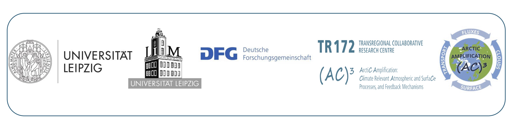

.. storypy documentation master file

storypy
=======

**storypy** is a Python toolkit for analysing dynamical climate storylines in multi-model
ensembles, for research and for policy applications.

It implements the dynamical storyline framework of
`Zappa & Shepherd (2017) <https://doi.org/10.1175/JCLI-D-16-0807.1>`_ for CMIP model
output, with configurable remote drivers, target seasons, regions and climate variables
(or climatic-impact drivers).

It covers the whole analysis:

- **Preprocessing**: CMIP data through ESMValTool (Option A) or from local NetCDF files
  (Option B), normalised by each model's global warming.
- **Driver indices**: remote drivers (e.g. tropical warming, the stratospheric polar
  vortex, Niño3.4 SST) scaled by global warming and standardised across models.
- **Regression**: multiple linear regression of the target change onto the drivers at every
  gridpoint, with p-values, R² and relative importance.
- **Significance**: model agreement (β criterion) and signal-to-noise against piControl
  variability (γ criterion).
- **Storylines**: construction and plotting of physically motivated storylines.

.. code-block:: bash

   pip install storypy

New here? Start with the :ref:`overview`, then run the :ref:`quickstart` on the bundled
sample data.

.. toctree::
   :maxdepth: 1
   :caption: Getting started

   getting_started/overview
   getting_started/installing
   getting_started/quickstart
   getting_started/configuration
   getting_started/picontrol_recipe

.. toctree::
   :maxdepth: 1
   :caption: Tutorials

   Zappa & Shepherd (2017) <https://nbviewer.org/github/LIM-Climate-Causality/storypy/blob/main/notebooks/sp_zs_2017.ipynb>
   Mindlin et al. (2020) <https://nbviewer.org/github/LIM-Climate-Causality/storypy/blob/main/notebooks/sp_mindlin_2020.ipynb>
   Monerie et al. (2023) <https://nbviewer.org/github/LIM-Climate-Causality/storypy/blob/main/notebooks/sp_monerie_2023.ipynb>
   Ghosh et al. (2023) <https://nbviewer.org/github/LIM-Climate-Causality/storypy/blob/main/notebooks/sp_ghosh_2023.ipynb>

.. toctree::
   :maxdepth: 2
   :caption: API reference

   reference/preprocess
   reference/compute
   reference/evaluate
   reference/data
   reference/config

.. toctree::
   :maxdepth: 1
   :caption: Development

   development/contributing
   development/changelog

How to cite
-----------

Alawode, R., Mindlin, J., Kretschmer, M., *et al.* (2024).
*storypy: A Python interface for climate storyline computation.*

License
-------

**storypy** is available under the open source
`MIT License <https://github.com/LIM-Climate-Causality/storypy/blob/main/LICENSE>`_.

Acknowledgements
----------------

The development of this package was supported by the **Leipzig Institute for Meteorology
(LIM)**, with partnership funding from the **Deutsche Forschungsgemeinschaft (DFG)** under
AC3.

